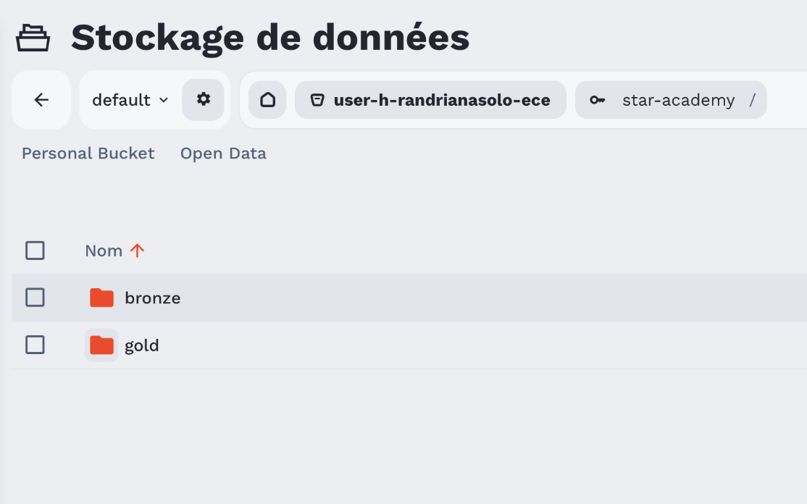
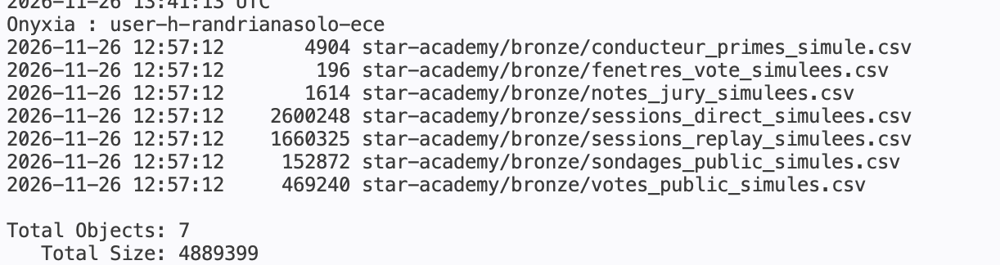
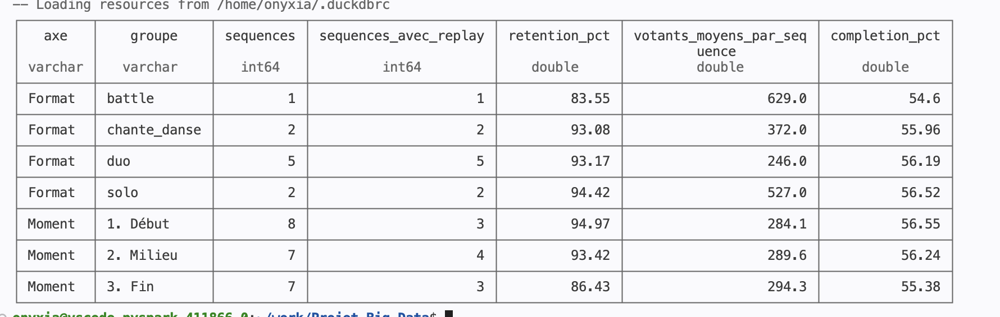

# Star Academy — Comment programmer un prime qui retient le public ?

## Auteurs

- Pia
- Harisoa

## Jeu de données

**Star Academy 2025–2026 — audience simulée** · Généré le **26 novembre 2026** · **7 CSV, 69 698 lignes de données, 4 889 399 octets hors compression (4,89 Mo)**.  
**Licence du jeu généré** — [à renseigner par les auteurs].

Nous avons utilisé une IA pour effectuer un relevé ciblé de sources publiques sur les primes des **25 octobre et 1er novembre 2025**. Ce relevé a remplacé le scraping automatisé et fourni une sélection de prestations, avec leurs formats et les artistes invités lorsqu’ils étaient documentés. Un générateur Python à graine fixe a ensuite produit un jeu reproductible dont le volume respecte la limite de **1 à 5 Mo**.

Le **conducteur** rattache ces prestations à des séquences dont l’ordre et les horaires ont été reconstruits pour le projet. Les six autres CSV simulent les sessions en direct, les notes du jury, les sondages du public, les fenêtres de vote, les votes et les lectures en replay. Ces données permettent de tester ensemble trois formes d’engagement. Les résultats décrivent le scénario simulé. La méthode et les sources sont détaillées dans [PROVENANCE.md](PROVENANCE.md).

[TF1+ · Prime du 25 octobre](https://www.tf1.fr/tf1/star-academy/videos/star-academy-2025-prime-2-partie-1-du-25-octobre-2025-04437941.html) · [TF1+ · Prime du 1er novembre](https://www.tf1.fr/tf1/star-academy/videos/star-academy-2025-prime-3-partie-1-du-1-novembre-2025-95947030.html) · [Stars Actu · Programme annoncé du 25 octobre](https://www.stars-actu.fr/2025/10/star-academy-les-duos-et-chansons-du-2eme-prime-du-25-octobre-devoiles/)

## Problématique

Quels formats et moments du prime sont associés à la meilleure rétention en direct, au plus grand nombre de votants et à la meilleure complétion en replay ?

## Architecture et chemins S3

| Couche | Contenu | Chemin |
|---|---|---|
| **Bronze** | Les sept CSV d’entrée | `s3://user-h-randrianasolo-ece/star-academy/bronze/` |
| **Gold** | Le Parquet final, avec une ligne par séquence | `s3://user-h-randrianasolo-ece/star-academy/gold/indicateurs_sequences.parquet` |

L’AWS CLI récupère les CSV Bronze dans la session Onyxia. DuckDB calcule les indicateurs à partir de ces fichiers, puis l’AWS CLI publie le Parquet dans Gold.



## Reproduction

Depuis la racine du dépôt, dans le terminal Bash d’Onyxia, utiliser **AWS CLI**, **DuckDB** et le profil S3 `default` avec les droits de lecture sur Bronze et d’écriture sur Gold.

```bash
(
  set -euo pipefail
  S3="s3://user-h-randrianasolo-ece/star-academy"
  DONNEES=$(mktemp -d)

  aws s3 --profile default cp "$S3/bronze/" "$DONNEES/" \
    --recursive --exclude "*" --include "*.csv"

  {
    printf "SET VARIABLE dossier_donnees = '%s';\n" "$DONNEES"
    cat src/indicateurs_sequences.sql
  } | duckdb -bail

  aws s3 --profile default cp "$DONNEES/indicateurs_sequences.parquet" \
    "$S3/gold/indicateurs_sequences.parquet"

  {
    printf "SET VARIABLE resultat_parquet = '%s';\n" "$DONNEES/indicateurs_sequences.parquet"
    cat src/comparer_indicateurs.sql
  } | duckdb -bail
)
```

Pour **relancer le pipeline**, rejouer le bloc complet. Il crée un nouveau dossier temporaire et republie le Parquet à la même adresse S3. Pour **reconstituer les entrées**, exécuter `python3 src/generer_donnees.py`, puis déposer les sept CSV produits dans Bronze.

## Preuves d’exécution

### 01 — Dépôt des données brutes dans Bronze

La liste S3 permet de comparer le contenu déposé au jeu attendu, soit **7 CSV et 4 889 399 octets**. Ce contrôle repère un transfert incomplet avant que le pipeline ne lise les fichiers.



### 02 — Lecture du conducteur dans DuckDB

DuckDB lit la copie du conducteur récupérée depuis S3 et compte **22 séquences, dont 10 prestations**. Le conducteur fournit les horaires pour rattacher les événements du direct aux séquences et les identifiants de prestation pour relier les replays.


### 03 — Contrôles qualité avant les jointures

Les contrôles portent sur l’unicité des identifiants de séquence et de vote, l’unicité des clés de fenêtre et la validité du rattachement des votes. Une fenêtre dupliquée pourrait multiplier les votes à la jointure. Le contrôle temporel vérifie qu’un vote se situe entre l’ouverture incluse et la fermeture exclue.


### 04 — Calcul des indicateurs par séquence

Le pipeline agrège le direct, les votes et les replays séparément avant de les joindre au conducteur. Cela évite de compter un vote autant de fois qu’il y a de lectures en replay. La sortie conserve **une ligne par séquence**, avec les effectifs utilisés pour calculer et interpréter les taux.


### 05 — Publication du résultat dans Gold

Le fichier `indicateurs_sequences.parquet` est publié sous `gold/`. La liste S3 vérifie que le résultat est disponible après la fin de la session Onyxia et qu’il peut être récupéré pour une autre analyse.


### 06 — Vérification indépendante du comptage

Python relit les CSV bruts et recompte les votes dans les bornes de la séquence et de la fenêtre de vote. Pour `prime_02_seq_02`, il retrouve **333 votes et 333 votants distincts**, comme dans le Parquet récupéré depuis S3. Cet accord vérifie le comptage sur une séquence avec une autre implémentation.


### 07 — Comparaison des formats et des moments du prime

| Indicateur | Résultat dans la simulation |
|---|---|
| **Rétention en direct** | **94,97 % en début de prime** et **86,43 % en fin de prime**, soit **8,54 points d’écart**. |
| **Vote** | Le battle réunit **629 votants**, sur une seule séquence. |
| **Complétion en replay** | Le solo arrive en tête des formats observés, avec **56,52 %** sur deux prestations. |

Les effectifs par groupe aident à interpréter le classement. Le nombre de votants dépend aussi des fenêtres de vote. Les résultats portent sur deux primes simulés à partir d’une sélection de prestations publiques.

