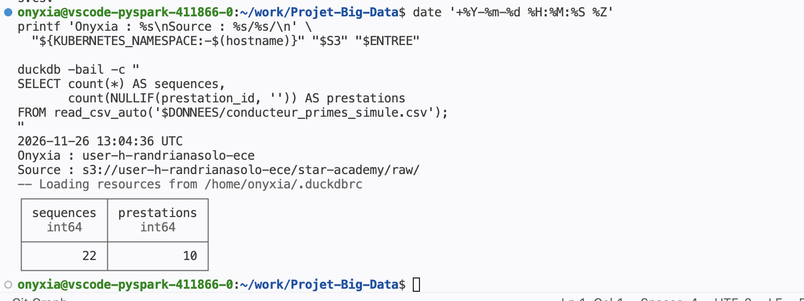
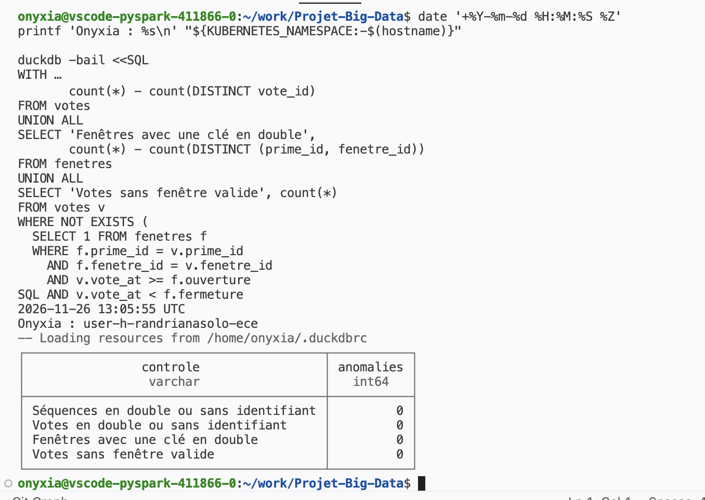
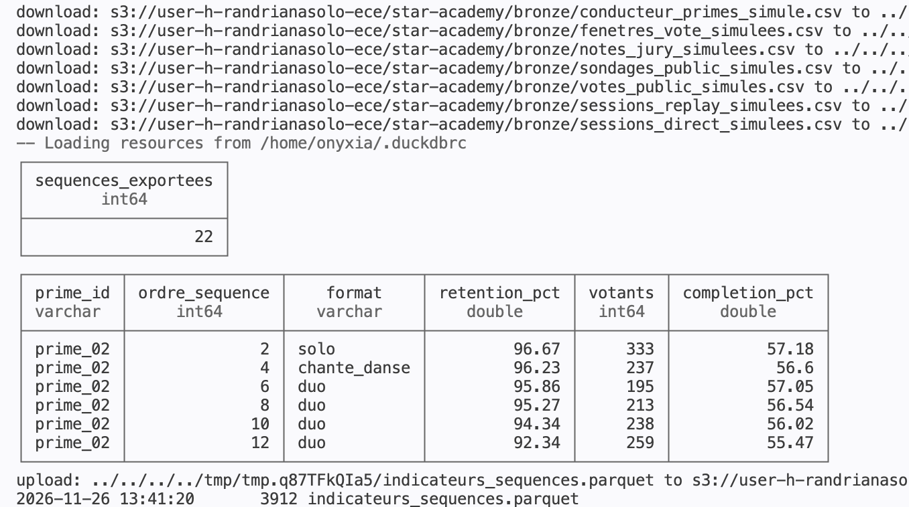
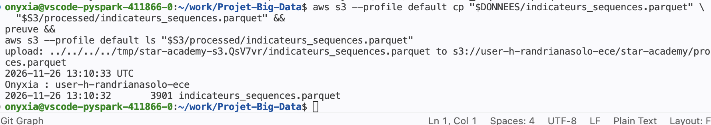
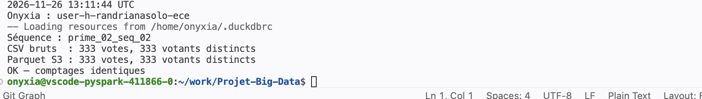

# Star Academy — Comment programmer un prime qui retient le public ?

## Auteurs

- [NOM Prénom]
- [NOM Prénom]

## Jeu de données

**Star Academy 2025–2026 — audience simulée.** Le jeu a été généré le **26 novembre 2026**. Il comprend **7 CSV, 69 698 lignes et 4 889 399 octets hors compression (4,89 Mo)**. Licence du jeu généré — [à renseigner par les auteurs].

Nous avons utilisé une IA pour effectuer un **relevé ciblé de sources publiques** sur les primes du **25 octobre et du 1er novembre 2025**. Cette méthode a remplacé le scraping automatisé. Le relevé a fourni une sélection de prestations, puis un **générateur Python à graine fixe** a réglé le volume des données simulées pour respecter la limite de 5 Mo et permettre de reproduire les mêmes CSV.

Le **conducteur** associe les prestations documentées à des horaires et à un ordre de passage reconstruits. Les six autres CSV contiennent les sessions de direct, les notes du jury, les sondages du public, les fenêtres de vote, les votes et les lectures en replay. Ces six sources sont simulées. Les résultats décrivent donc le scénario généré. Les URL figurent dans le conducteur et la méthode est détaillée dans [PROVENANCE.md](PROVENANCE.md).

Sources publiques — [TF1+ · 25 octobre](https://www.tf1.fr/tf1/star-academy/videos/star-academy-2025-prime-2-partie-1-du-25-octobre-2025-04437941.html) · [TF1+ · 1er novembre](https://www.tf1.fr/tf1/star-academy/videos/star-academy-2025-prime-3-partie-1-du-1-novembre-2025-95947030.html) · [Stars Actu · programme annoncé du 25 octobre](https://www.stars-actu.fr/2025/10/star-academy-les-duos-et-chansons-du-2eme-prime-du-25-octobre-devoiles/)

## Problématique

Quels formats et moments du prime sont associés à la meilleure rétention en direct, au plus grand nombre de votants et à la meilleure complétion en replay ?

## Chemins S3

| Données | Chemin |
|---|---|
| Sept CSV d’entrée | `s3://user-h-randrianasolo-ece/star-academy/raw/` |
| Indicateurs par séquence | `s3://user-h-randrianasolo-ece/star-academy/processed/indicateurs_sequences.parquet` |

## Reproduction

Depuis la racine du dépôt, dans le terminal Bash d’Onyxia, avec **AWS CLI**, **DuckDB** et le profil S3 `default` configuré, exécuter le bloc suivant.

```bash
(
  set -euo pipefail
  S3="s3://user-h-randrianasolo-ece/star-academy"
  DONNEES=$(mktemp -d)

  aws s3 --profile default cp "$S3/raw/" "$DONNEES/" \
    --recursive --exclude "*" --include "*.csv"

  {
    printf "SET VARIABLE dossier_donnees = '%s';\n" "$DONNEES"
    cat src/indicateurs_sequences.sql
  } | duckdb -bail

  aws s3 --profile default cp "$DONNEES/indicateurs_sequences.parquet" \
    "$S3/processed/indicateurs_sequences.parquet"

  {
    printf "SET VARIABLE resultat_parquet = '%s';\n" "$DONNEES/indicateurs_sequences.parquet"
    cat src/comparer_indicateurs.sql
  } | duckdb -bail
)
```

Pour relancer le traitement, rejouer le bloc complet. Chaque exécution récupère les entrées dans un nouveau dossier temporaire et publie le résultat à la même adresse S3. Pour régénérer les entrées, exécuter `python3 src/generer_donnees.py`, puis déposer les sept CSV produits sous `star-academy/raw/`.

## Preuves d’exécution

### 01 — Ingestion des données sur S3

La liste S3 affiche les **sept CSV** et leur taille cumulée de **4 889 399 octets**. Ce contrôle permet de vérifier que les objets attendus sont disponibles avant le traitement.


### 02 — Lecture du conducteur dans DuckDB

DuckDB lit la copie du conducteur téléchargée depuis S3 dans Onyxia et compte **22 séquences, dont 10 prestations**. Le conducteur fournit les horaires et les identifiants qui permettent de rattacher les événements aux séquences.



### 03 — Contrôles qualité avant les jointures

Les requêtes vérifient l’unicité des identifiants de séquence et de vote, l’unicité des fenêtres et la validité du rattachement des votes. Une clé de fenêtre dupliquée pourrait compter deux fois un même vote. Un vote hors fenêtre doit être écarté du calcul.



### 04 — Calcul des indicateurs par séquence

Le SQL agrège le direct, les votes et les replays séparément avant de les joindre au conducteur. Cela évite, par exemple, de répéter un vote pour chaque lecture replay. La sortie contient **une ligne par séquence**, avec les effectifs nécessaires pour interpréter les taux.



### 05 — Publication du résultat sur S3

Le fichier `indicateurs_sequences.parquet` apparaît dans `processed/` avec une taille de **3 901 octets**. Cette étape rend le résultat accessible après la fin de la session Onyxia et permet de le retélécharger pour la vérification.



### 06 — Vérification indépendante

Un calcul Python repart des CSV bruts et utilise les horaires de la séquence et de sa fenêtre de vote. Pour `prime_02_seq_02`, il retrouve **333 votes et 333 votants distincts**, les mêmes valeurs que dans le Parquet téléchargé depuis S3.



### 07 — Comparaison des formats et des moments du prime

Dans la simulation, la rétention atteint **94,97 % en début de prime** et **86,43 % en fin de prime**, soit **8,54 points d’écart**. Le solo affiche la meilleure complétion parmi les formats observés (**56,52 %**, sur deux prestations). Le battle arrive en tête pour les votants (**629**, sur une seule séquence). Les effectifs par groupe et l’ouverture des fenêtres de vote sont à prendre en compte pour interpréter ces résultats.

